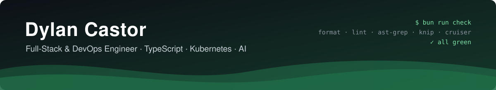

    

Full-stack & DevOps engineer based in France. I design, ship and run complete products: TypeScript and Python on the app side, Kubernetes and CI/CD on the infra side, and AI built in where it pays off.

### What I build

- **A Shopify A/B testing app** (SaaS, on the Shopify App Store): flicker-free test engine on live stores, Bayesian and frequentist stats, Admin GraphQL API, Theme App Extensions, Web Pixels.
- **An AI tool to redesign UI components**: oRPC contract served by Hono and Fastify in parallel, PostgreSQL + Drizzle, pg-boss jobs, live updates over SSE, Claude behind a provider-agnostic port.
- **TightStack** *(private for now)*: a strict TypeScript / React template that keeps AI coding agents on rails. Hexagonal architecture enforced by 98 dependency-cruiser rules, 75 custom ast-grep rules, strict tsconfig and type-aware lint, all in one gate run locally, in git hooks and in CI.
- **[cluster_infra](https://github.com/DylanC-Code/cluster_infra)**: the source of truth of my production k3s cluster. Ansible for the machines, layered clusters / platform / apps, ADRs, runbooks and tests.

### How I work

- Types that make invalid states impossible, errors as values (`Result`), no `any`, no casts.
- Business logic in a framework-free core; HTTP, database and queues are adapters you can swap.
- Every decision written down with its reason and the options rejected.
- AI agents as leverage, reviewed like a colleague's merge request.

### Stack

   
   
  

### Activity (public + private repos)

  
  

### Low-level side

Trained at 42 Paris: C, C++, assembly. Pinned below: an [HTTP server in pure x86-64 assembly](https://github.com/DylanC-Code/x86_64-http-server) and a [kernel written from scratch](https://github.com/DylanC-Code/KFS_1__42).

---

📫 [dylan@dylancastor.com](mailto:dylan@dylancastor.com) · [LinkedIn](https://www.linkedin.com/in/dylan-code) · [dylancastor.com](https://dylancastor.com)
